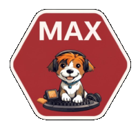

# Welcome to DSB on GitHub

Welcome to DSB’s GitHub presence.

DSB is the Danish national railway company. Every day we help thousands of passengers get to work, school, family and leisure activities safely and on time. Behind the trains you see on the tracks is a large digital ecosystem that plans, operates and continuously improves the railway.

## About DSB IT

DSB IT builds and runs the digital backbone of Danish rail transport. Our solutions support the full journey from planning to operations and follow-up, for both passengers and colleagues:

    Planning the traffic – systems for timetables, rolling stock, crew planning and capacity use
    Running the traffic – operational tools that support traffic control, station operations and on‑train staff
    Evaluating and improving – analytics and decision-support that help us run more reliably and efficiently

We work on everything from internal tools and workshop systems, to apps for our staff, and the public-facing digital experience like ticketing, self-service and travel information. In the private part of our GitHub organisation you will find parts of that ecosystem in the form of libraries, utilities, examples and configuration that we believe can be useful or interesting outside DSB as well.

## Our Platforms: MAX and Observability

To support all these solutions we operate an internal developer platform called MAX. MAX brings together our experience with DevOps, cloud and monitoring into a unified way of:
    
    Building and deploying microservice-based applications on Kubernetes
    Organising services around domains and teams
    Giving developers fast feedback when changes misbehave in non‑production environments

Alongside MAX we have a modern observability platform based on Prometheus, the Grafana stack and ClickHouse. This setup gives our teams insight into how services perform in production and helps us detect issues early, understand incidents and continuously improve reliability.

## Stay Connected

If you are curious about DSB, our digital journey or career opportunities in DSB IT, visit our website at dsb.dk and our careers pages.

Thanks for stopping by – and thanks for taking an interest in the technology behind the trains.
